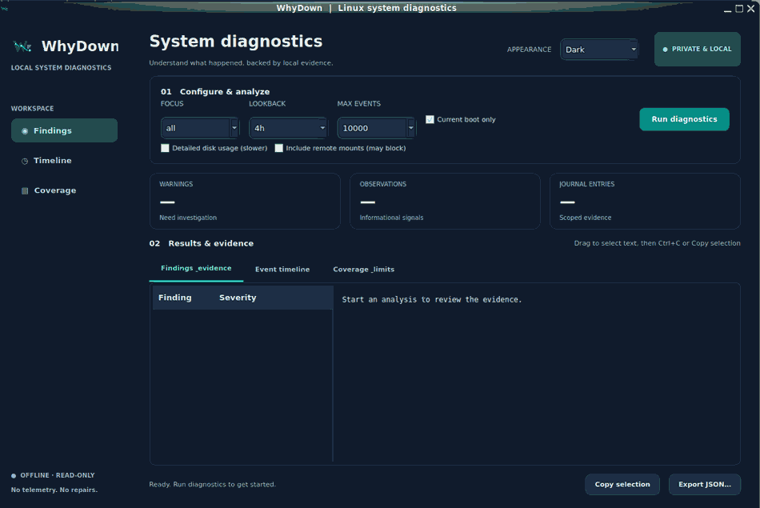

<p align="center">
  
</p>

# WhyDown

**Linux diagnostics with evidence — without changing your system.**

WhyDown detects common system, network, storage and service incidents from
local Linux state and journals. Examine findings through a desktop GUI, a
guided terminal menu or the command line.

<p align="center">
  
</p>

<p align="center"><em>WhyDown Qt 6 desktop on Linux — Dark theme and official WD logo, before a diagnostic run.</em></p>

**Read-only · Offline · No telemetry · GPL-3.0-only**

## Install in 2 minutes

Linux **x86_64 or ARM64** (Manjaro/Arch, Debian, Ubuntu, Raspberry Pi OS and
other compatible distributions). The installer downloads a release binary,
checks its SHA-256 checksum and does not require Rust or `sudo`.

```bash
git clone https://github.com/hamdyaea/WhyDown.git
cd WhyDown
sh scripts/install.sh
~/.local/bin/whydown --version
```

**Want a desktop application menu entry?** Run:

```bash
sh scripts/install.sh --desktop
```

The installer checks optional graphical dependencies and tells you what is
missing. It does **not** install system packages automatically.

### GUI prerequisites (Qt 6)

The CLI and terminal menu do not require Python or Qt. For the desktop GUI,
install Python 3 and PyQt6 with your Linux package manager:

| Distribution | Install GUI prerequisites |
| --- | --- |
| Manjaro / Arch | `sudo pacman -S python python-pyqt6` |
| Debian / Ubuntu | `sudo apt install python3 python3-pyqt6` |
| Fedora | `sudo dnf install python3 python3-pyqt6` |

Verify before starting: `sh scripts/install.sh --check-gui-prereqs`.

## Launch WhyDown

| Interface | Command | Best for |
| --- | --- | --- |
| **Graphical GUI** | `~/.local/bin/whydown gui` | Desktop, mouse navigation, evidence and timeline |
| **Terminal TUI** | `~/.local/bin/whydown tui` | SSH, servers, guided menus |
| **Command line** | `~/.local/bin/whydown diagnose` | Shell, scripts, automation |
| **Nagios / Icinga** | `~/.local/bin/whydown nagios check --metric all` | Monitoring, thresholds, performance data |

If `~/.local/bin` is in your `PATH`, use `whydown` instead of the full path.

The GUI starts in **Dark** mode on first launch. Change **Appearance** to
*Dark*, *Light* or *System* at any time. Your explicit choice is remembered.

**Investigate an alert:** after a diagnosis, the first page lists the exact
affected interfaces or systemd units when identifiable, times and event counts.
**Double-click an incident** to open a detailed page with matched journal
indicators (e.g. Wi-Fi reason or service exit status), current state and
read-only verification commands. Nothing is repaired or uploaded.

## Useful commands

```bash
# Inspect all areas over the last 4 hours (current boot)
~/.local/bin/whydown diagnose --focus all --since 4h --current-boot

# Troubleshoot the network only
~/.local/bin/whydown diagnose --focus network --since 2h

# Run a guided terminal investigation
~/.local/bin/whydown tui

# Explore a fictional example without reading your computer
~/.local/bin/whydown gui --demo
~/.local/bin/whydown tui --demo

# Save a private structured report
~/.local/bin/whydown diagnose --format json --output report.json

# Export a readable HTML report
~/.local/bin/whydown diagnose --format html --output report.html

# Show every CLI option
~/.local/bin/whydown --help

# Show the WD project logo in ASCII
~/.local/bin/whydown logo
```

## Nagios / Icinga monitoring and graphs

Standard plugin states, thresholds, performance data and offline SVG/HTML charts:

```bash
whydown nagios check --metric memory --warning 80 --critical 95
whydown nagios check --metric all --record /path/to/private/nagios.tsv
whydown nagios dashboard --history /path/to/private/nagios.tsv --output dashboard.html
```

Create the history directory first. See [Nagios setup](docs/NAGIOS.md).

## Update WhyDown

From an existing Git checkout:

```bash
cd ~/WhyDown
git pull --ff-only
sh scripts/install.sh --desktop
~/.local/bin/whydown --version
```

For a terminal-only machine, omit `--desktop`. The installer downloads
published binaries and requires network access **only to install/update**;
diagnostics never contact an external server.

## What it examines

WhyDown can highlight historical service failures, network link/DHCP/DNS
signals, default-route issues, low disk space, filesystem and memory warnings,
resource pressure and incomplete Debian package states. It separates a
**historical observation** from a current snapshot where evidence is available.

**Limitations:** findings are investigation hints, not proof of a root cause;
missing journal access does not mean a healthy system; `active/running` does
not guarantee application readiness. WhyDown does not repair problems,
restart services or send logs anywhere. Check the suggested commands before
acting on them.

## Documentation

- [Desktop GUI and themes](docs/GUI.md)
- [Terminal TUI](docs/TUI.md)
- [JSON report schema](docs/REPORT_SCHEMA.md)
- [Validation / supported scenarios](docs/TEST_MATRIX.md)
- [Detailed project background & validation history](docs/PROJECT_HISTORY.md)
- [Changelog](CHANGELOG.md) · [Releases](https://github.com/hamdyaea/WhyDown/releases)

## Develop from source

Requires the Rust toolchain. This project uses **no third-party Rust crates**.

```bash
git clone https://github.com/hamdyaea/WhyDown.git
cd WhyDown
cargo test --locked
cargo build --release --locked
./target/release/whydown --version
```

Contributions are welcome: see [CONTRIBUTING.md](CONTRIBUTING.md). Do not
publish unsanitized diagnostic logs in issues.

**License:** [GPL-3.0-only](LICENSE). © 2026 Hamdy Abou El Anein and contributors.
